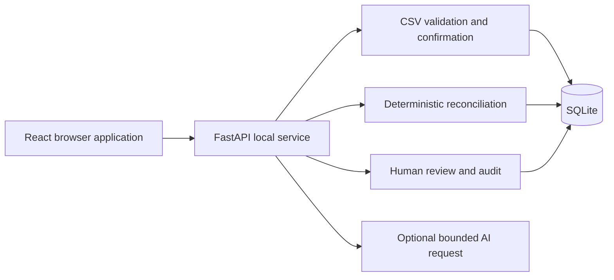

# ReconcileOS Technical Specification

## How This Works, In Plain Language

The browser application sends CSV files to a Python service running on the same laptop. The service validates each file, keeps a preview, and writes financial records only when the operator confirms a valid import. Records and review history live in the local SQLite database and survive restart.

When the operator starts reconciliation, the service takes a fixed copy of the imported records and rule configuration. A deterministic Python engine compares that copy, records explainable matches, and opens cases for evidence gaps or differences. The browser reads those stored results. Human decisions create explicit review records and audit entries; the original source records and automatic results remain available.

Optional AI assistance sends a small selection of a case's evidence to a server-configured provider. Its validated response is a hypothesis for the operator to review. Matching, case resolution, and all financial arithmetic remain ordinary application code.

The learner chose a modular monolith: one backend, one frontend, and one local database. The details below derive from that choice and the approved PRD. The learner approved the displayed specification by responding "proceed".

## The Core Journey Through the System

1. The browser loads workspace information, provider and currency definitions, configured fee-rule availability, recent imports, and completed runs from the API.
2. A selected CSV is streamed to the preview endpoint. The import service enforces limits, decodes and parses it, validates every row, and stores the preview and provenance without creating orders, payments, or settlements.
3. Confirmation serializes with other workspace writes, validates batch state, inserts the entire valid batch, advances the input revision, and appends an audit event in one transaction.
4. A run captures a consistent input snapshot, checksum, and rule configuration. The pure engine computes results from that snapshot. A transaction persists all results and the completed status together.
5. Results pages query persisted matches and cases. Search and filters operate on the selected run. Case detail joins source provenance and current review history to its original snapshot evidence.
6. Review actions validate the expected case version, reason, actor, evidence membership, and allocation constraints before persisting a decision and audit event atomically.
7. AI assistance uses bounded case evidence and a separate HTTP request. Only validated output is stored; failures return a safe error without changing financial state.
8. Reports derive from the same selected run and review state. CSV output neutralizes spreadsheet formulas in imported text.

Implements `prd.md > The Core Journey`.



## Stack

| Component | Choice and rationale | Primary documentation |
| --- | --- | --- |
| Backend runtime | Python 3.11 or newer; the available laptop runtime is Python 3.14.3. Verify dependency installation against that runtime in the first build slice. | [Python](https://docs.python.org/3/) |
| HTTP API | FastAPI, Uvicorn, Pydantic 2, and pydantic-settings for typed input, output, and environment configuration. | [FastAPI](https://fastapi.tiangolo.com/), [Uvicorn](https://www.uvicorn.org/), [Pydantic](https://docs.pydantic.dev/latest/), [Settings](https://docs.pydantic.dev/latest/concepts/pydantic_settings/) |
| Persistence | SQLAlchemy 2.x ORM, Alembic migrations, and Python's SQLite driver locally. Include Psycopg 3 for later independent PostgreSQL verification. | [SQLAlchemy](https://docs.sqlalchemy.org/en/20/), [Alembic](https://alembic.sqlalchemy.org/en/latest/), [Psycopg](https://www.psycopg.org/psycopg3/docs/) |
| Frontend | React, TypeScript, Vite, React Router, TanStack Query, Tailwind CSS, and Lucide React, as selected by the learner. | [React](https://react.dev/), [TypeScript](https://www.typescriptlang.org/docs/), [Vite](https://vite.dev/guide/), [Router](https://reactrouter.com/start/declarative/installation), [Query](https://tanstack.com/query/latest/docs/framework/react/overview), [Tailwind](https://tailwindcss.com/docs/installation/using-vite), [Lucide](https://lucide.dev/guide/packages/lucide-react) |
| Provider HTTP | HTTPX with explicit timeouts and response limits; no provider SDK is required for the documented adapter contract. | [HTTPX](https://www.python-httpx.org/) |
| Backend verification | Pytest and FastAPI TestClient, with real migrated temporary SQLite databases and pure engine fixtures. | [Pytest](https://docs.pytest.org/en/stable/), [TestClient](https://fastapi.tiangolo.com/tutorial/testing/) |
| Frontend verification | Vitest and Testing Library for critical interactions; Playwright for the full browser journey if available. | [Vitest](https://vitest.dev/guide/), [Testing Library](https://testing-library.com/docs/react-testing-library/intro/), [Playwright](https://playwright.dev/docs/intro) |

Use supported compatible releases, record the installed versions in backend requirements and package-lock.json, and report actual installation and test results. Exact dependency versions and Python 3.14 wheel availability have not yet been verified by installation. No third-party application implementation is copied into this project.

## Where It Runs and How Someone Tries It

All initial development and tests run natively on Windows. The API listens on 127.0.0.1:8000 and the frontend on 127.0.0.1:5173. Vite uses a strict port so a changed port does not silently break CORS. Configure the browser API root using VITE_API_BASE_URL.

The following commands are the implementation target and must be executed and corrected during the build before the README presents them as verified instructions.

Backend, from the repository root:

```powershell
cd backend
py -m venv .venv
Copy-Item .env.example .env
.\.venv\Scripts\python.exe -m pip install -r requirements.txt
.\.venv\Scripts\python.exe -m alembic upgrade head
.\.venv\Scripts\python.exe -m uvicorn app.main:app --host 127.0.0.1 --port 8000 --reload
```

Frontend, in another terminal from the repository root:

```powershell
cd frontend
Copy-Item .env.example .env
npm.cmd ci
npm.cmd run dev -- --host 127.0.0.1
```

Open http://127.0.0.1:5173. API documentation is at http://127.0.0.1:8000/docs. Virtual environment activation is optional; direct executable invocation avoids changing PowerShell execution policy. npm install remains available for intentionally refreshing dependencies; npm ci reproduces the committed lockfile.

The recording uses synthetic CSVs from sample-data, import confirmation, a reconciliation run, an evidence-backed review action, and CSV export. Submission preparation requires the short demo video and a public GitHub repository. No deployment is part of the initial build.

Implements `prd.md > Synthetic Demonstration and Verification`.

## Look and Feel

Implement `prd.md > Look and Feel` as shared CSS tokens and a small set of reusable components. Use the exact approved palette, 14px operational body text, readable table headings, 4px to 6px corner radii, visible keyboard focus, compact controls, and restrained Lucide icons. Self-host Inter through a small font package if available, with a system sans-serif fallback. The core workflow must remain usable without a font download.

Use solid backgrounds and subtle borders, without the forbidden colors or effects. On narrower screens, navigation and controls remain usable and tables scroll horizontally. Shared primitives cover buttons, status labels, inputs, cards, tables, errors, loading, and empty states. The application opens directly into the dashboard and operational workflow.

## Components

### Configuration and Persistence

Central settings resolve DATABASE_URL, explicit allowed browser origins, LOCAL_OPERATOR, upload limits, fee-rule location, and optional provider settings. The default database URL is sqlite:///./data/reconcileos.db, resolved relative to backend rather than whichever directory invoked the process. Application startup requires an applied schema and does not silently replace migrations with create_all.

For SQLite, configure check_same_thread=False, a bounded busy timeout, foreign_keys=ON on every connection, and explicit transaction handling compatible with Python 3.11 and newer. Use SQLAlchemy connection events to disable the driver's legacy implicit transaction handling and issue explicit BEGIN; do not mix that approach with an incompatible driver autocommit setting. Migration and test connections use the same factory. See [SQLAlchemy SQLite transaction and foreign-key guidance](https://docs.sqlalchemy.org/en/20/dialects/sqlite.html).

Every mutation affecting inputs or allocations first updates the single workspace's revision counter in its transaction, acquiring a database write lock for that workspace. This serializes import confirmation, snapshot capture, and review allocation without relying on SQLite-only business queries. Review actions also use a case version comparison to reject stale requests.

Implements `prd.md > Local Workspace and Record Integrity` and `prd.md > States and Boundaries`.

### CSV Import Service

Accept raw CSV, TSV, XLSX, XLS, and XLSM bytes from the browser's selected File, with source_type in the URL and an encoded display filename in X-Filename. Read request chunks with a 10 MiB limit and accept at most 10,000 transaction rows. Recognize UTF-8, BOM-marked UTF-16, and Windows-1252 text, and detect comma, semicolon, tab, and pipe separators. Recognize common business headings and preambles; unfamiliar or duplicate headings require column selection rather than rewriting the file. Bound Excel expansion, worksheets, columns, and cells; use read-only readers with XML protection and no macro or external-link execution.

Normalize the display filename by removing path components and control characters. Never use it as a filesystem path. Uploaded source content and parsed rows are stored in database JSON fields, not written to a user-selected path. Preserve original header values and extra columns as provenance. Restrict identifier and description lengths, bound validation feedback, and paginate preview rows while retaining all validation outcomes for the bounded file.

Canonical fields and optional template columns. Existing source headings are mapped to these fields rather than required to use these names:

| Source | Columns |
| --- | --- |
| Orders | order_ref, amount, currency, ordered_at, status; optional description |
| Payments | provider, transaction_ref, order_ref, amount, currency, paid_at, status; optional description |
| Settlements | provider, settlement_ref, payment_ref, gross_amount, fee_amount, net_amount, currency, settled_at; optional description |

Order status accepts open, completed, and cancelled; cancelled orders stay visible and are excluded from automatic allocation. Payment status accepts successful, pending, failed, and reversed. Common source synonyms are recognized, but unfamiliar payment statuses require an explicit operator classification and are never assumed successful. Normalize known provider aliases, preserving distinct other named providers rather than rejecting them or merging all gateways. Provider labels do not establish live integrations. References remain case-sensitive. Preserve original values and every interpretation choice.

Read common date formats and native Excel dates using a visible date-order and timezone setting. Normalize the interpreted date to UTC. Missing dates require a mapped field or an explicit statement date; ambiguous local times are not guessed. Amount fields use exact normalization and the Money Rules below. Orders, payments, and settlement gross amounts must be positive; fees and net amounts may be zero. A numerically valid but inconsistent gross/fee/net equation is retained with a warning so reconciliation can investigate it. Missing optional relationship references are valid evidence gaps.

The same row appearing twice is a warning, with row hashes and provenance retained. No reference-only uniqueness constraint discards repeated notification evidence. ImportBatch has a unique workspace/source/SHA-256 checksum key. Re-uploading a confirmed batch returns its existing identity and status without duplicate records. Original source cells are immutable. Before confirmation, the operator may revise column mapping, defaults, locale interpretation, and reasoned corrections or exclusions. Store revision history, preserve excluded cells, and reject stale interpretation requests. Only selected rows with no remaining errors can be confirmed; all selected rows commit atomically. Confirmed records cannot be remapped.

All financial inserts, confirmed status, row counts, workspace input revision, and import audit event commit atomically. Any failure rolls the transaction back. A concurrency conflict never leaves a partly confirmed batch.

Implements `prd.md > CSV Import and Validation`.

### Money Rules

Use Python integers and SQLAlchemy BigInteger minor-unit columns for stored money. Convert supported spreadsheet numeric cells to decimal text at the reading boundary; core financial calculations never use those binary cell values. Normalize explicit currency prefixes, valid grouping separators, supported decimal formats, exact scientific notation, and non-significant trailing zeros without changing monetary value. True precision beyond the currency unit remains an error. An ambiguous separator requires the operator to choose a format. Reject NaN, infinity, invalid or negative incoming amounts, unsupported currency, and implicit rounding. Limit each amount to 1,000,000,000,000 minor units.

The initial explicit precision table is GHS=2, USD=2, EUR=2, GBP=2, JPY=0, and KWD=3. Unsupported codes are rejected. The workspace base currency is GHS; that does not convert other currencies or permit them to be combined.

Send monetary minor units as decimal integer strings in API responses. The TypeScript client formats them using BigInt and the currency precision table, avoiding binary floating-point calculations and unsafe large-integer conversion. Counts remain ordinary integers. CSV exports include currency, minor units, and an exact decimal representation.

Automatic amount tolerance is zero. Expected fees use configured non-negative integer basis points and fixed minor units for a provider/currency pair. Round the percentage component half up to the nearest minor unit: (gross_minor * basis_points + 5000) // 10000, then add fixed_minor. Record the exact rule in each run snapshot.

No fees are assumed when configuration is absent. sample-data/fee-rules.json contains explicitly synthetic demonstration rules; backend/.env.example points to it with clear demo labeling. Real reconciliation requires operator-supplied rules. Missing fee configuration creates a fee_rule_missing review case, rather than assuming zero fees or claiming an exact settlement match.

Implements `prd.md > Local Workspace and Record Integrity`, `prd.md > Deterministic Reconciliation`, and `prd.md > Dashboard and Monetary Summaries`.

### Snapshot and Reconciliation Engine

The engine is a pure function of typed source records and immutable configuration. It does not import the web framework, access the database, call a provider, modify source records, or read the clock. Use stable sorting and deterministic case keys based on rule type and sorted source identities.

The run captures all confirmed source records, provenance identities, input revision, currency definitions, fee rules, and rule version in canonical JSON, with a SHA-256 snapshot hash. Snapshot capture uses the workspace write serialization described above. Computation then operates on the captured copy, so later imports cannot change its inputs. Newer imports are identified by revision in the UI; old results do not silently apply to them.

Run creation persists a running status and snapshot. Successful result persistence inserts all matches and cases and changes the status to completed in one transaction. An engine or persistence failure records a failed status with a safe explanation and does not expose partial matches. Runs interrupted by a process exit remain visibly incomplete and cannot masquerade as completed results.

Rules execute in stable stages:

1. Identify repeated row hashes and repeated payment keys. A payment key is the normalized provider plus transaction_ref. Any repeated payment key, including inconsistent statuses or currencies, blocks every member from automatic allocation. The duplicate notification count is the number of extra rows across these groups: sum(group_size - 1). Related order and settlement candidates remain evidence, not automatic allocations.
2. Form exact order-payment candidates from non-cancelled orders and successful payments outside duplicate groups. Require equal order_ref, currency, and amount. Accept a pair only when both the order and payment have exactly one valid candidate. Remaining competing pairs produce ambiguity cases.
3. Diagnose unallocated orders and payments. Use exact-reference evidence to identify currency differences, partial payments, amount differences, and duplicate-related review. An order without any successful same-reference payment evidence gets a missing_payment case. Every eligible payment without an accepted order relationship is an unmatched_payment case. An unknown order_ref is identified as an incorrect-reference reason within that case. Equal amount alone may support a review proposal but never an automatic match.
4. Form payment-settlement candidates using successful payments outside duplicate groups. Require equal provider, payment_ref to transaction_ref, currency, and gross amount. Exactly one candidate on both sides is necessary. Accept an exact settlement match only when net equals gross minus fee and the fee equals its configured expectation. Keep reference-linked fee, gross, currency, or net differences as explicit cases. Multiple candidates remain ambiguous.
5. A payment without any corresponding provider/reference settlement evidence gets missing_settlement_evidence. A reference-linked settlement difference is classified as a difference, rather than also claiming that no settlement record exists. Settlement records without reliable payment evidence remain linked to an unmatched settlement review case.

An order-payment match and payment-settlement match are separate relationship types. A payment may participate once in each. A source record cannot participate twice within a relationship type, and repeated notification records cannot bypass allocation checks by using different database row IDs.

Partial payments are identified from same-reference, same-currency payments below the order amount. Multiple partial payments remain unresolved even if their sum equals the order amount. The reason and candidate records are retained. AI does not participate in these stages.

Implements `prd.md > Deterministic Reconciliation` and `prd.md > Discrepancy Detection and Evidence`.

### Summary and Valuation Service

Persist the original automatic summary with the run. Compute current accepted-match values and unresolved case summaries from the snapshot plus active review decisions. Return both original_summary and current_summary so manual acceptance never rewrites automatic history. Dashboard and Reports identify the selected run and whether its snapshot predates newer imports.

All money is a map keyed by currency. Eligible payment count and total payment value include successful records outside repeated payment-key groups. Show excluded duplicate-group record counts and their recorded value separately; exclusion is a conservative review policy, not a finding that those funds do not exist. Human-accepted duplicate representatives can contribute to current accepted matches but do not rewrite the original eligible population.

Matched order value sums each accepted order's expected amount once. Matched settlement value sums each accepted settlement's recorded net amount once. Missing-payment counts refer to distinct affected orders; missing-settlement counts refer to distinct eligible payments with that case type. Category counts count cases and are not added into a loss total.

For unresolved discrepancy value, construct connected groups of unresolved cases using their linked source record identities and accepted match relationships. For each connected group and each currency, select one valuation level: sum distinct non-cancelled order amounts if present; otherwise sum payment amounts once per provider/transaction key; otherwise sum distinct settlement gross amounts. For inconsistent duplicate payment amounts within a currency, use the largest recorded amount for that key and identify this conservative valuation in the evidence. Sum group values per currency. The graph is built after applying the current accepted relationships, so linked order and payment cases cannot be valued twice. The interface labels the metric as affected recorded value, never confirmed loss. Separate currencies within a group remain separate.

Case counts exclude resolved cases. Reopening adds them back. The original run counts and automatic amounts remain inspectable. Tests must cover an order with several discrepancy types and duplicate records to verify this valuation rule independently.

Implements `prd.md > Dashboard and Monetary Summaries`.

### Human Review and Audit Service

Case statuses are open, in_review, resolved, and reopened. Notes are permitted without a status change. Permitted transitions are open/reopened to in_review or resolved, in_review to resolved, and resolved to reopened. Reject repeated or invalid transitions with a conflict response. Each consequential request includes expected_version, a reason of 3 to 2000 characters, and a bounded local operator identifier. The actor is an operational label, not verified authentication.

Candidate relationships live in the case's snapshot evidence. Approving a proposed order-payment relationship requires both IDs to be in the selected case's candidate evidence, eligible status, equal currency and amount, and no existing allocation for either record or logical payment key. Reference correction is permitted as an explicitly manual association with a documented reason. Do not waive amount, currency, eligibility, or duplicate-allocation invariants.

Approval creates a manual accepted match and appends an audit event; it does not automatically resolve all cases involving the same records. Rejecting a proposal appends the decision and leaves any unexplained case unresolved. Resolve and reopen actions record the operator's case disposition without claiming financial movement. Reopening preserves active match allocations unless the operator separately invokes reverse_match for a human-created match; reversal releases only that manual allocation and records the prior and new state. Automatic matches cannot be silently reversed through a case-status action.

Use case-version comparison, workspace write serialization, and database uniqueness on active allocations to prevent stale or concurrent double approval. Persist state, notes, match decisions, version increments, and audit entries in the same transaction. Store immutable decision and audit entries separately from mutable current status. No API updates or deletes audit events; model-level guards reject application ORM updates or deletes of them. Direct database administrators are outside this application-level guarantee.

Implements `prd.md > Human Review, Notes, and Audit History`.

### AI Investigation Adapter

Configuration is server-side: LLM_BASE_URL, LLM_API_KEY, LLM_MODEL, LLM_TIMEOUT_SECONDS, and LLM_RESPONSE_FORMAT. Require an HTTPS provider URL except an explicitly configured loopback test server. The URL is operator configuration, never an imported value or a client request parameter. Disable redirects and automatic retries. Missing settings return a clear 503 with ai_not_configured and do not create a fabricated investigation.

The adapter supports a chat-completion JSON contract: POST to the configured base URL plus /chat/completions, Authorization: Bearer with the server-side secret, model, a fixed system instruction, a user message containing only the bounded evidence JSON, and response_format requesting json_object or json_schema when explicitly supported. The response is read from choices[0].message.content as JSON. This is an adapter contract, not a claim that every provider supports it; the chosen provider's documentation and actual live request must be checked during configuration.

The learner selected OpenAI during implementation. Its prepared preset uses https://api.openai.com/v1 and gpt-5.4-mini-2026-03-17 with strict JSON schema output. The OpenAI request uses max_completion_tokens and store=false; compatible providers retain their documented max_tokens contract. Refusals and incomplete choices are rejected before persistence. The schema also constrains case and supporting-record IDs to allowed evidence. API keys remain local and are not distributed. The standalone verify_ai.py command authorizes one bounded request against an isolated synthetic database; an executed result is required before claiming live verification. See docs/ai-configuration.md for primary-source references.

Actual live inspection exposed a minor-unit wording error in the first hypothesis. AI context now provides currency precision plus separately labeled minor-unit, exact decimal, and display values for every monetary field. Formatting is shared with reports and uses integer arithmetic. The model must copy a display exactly when quoting an amount. Automated precision tests and a follow-up live synthetic request verified this correction without changing the financial engine or original records. Hypotheses still require human review.

The system instruction treats imported text as evidence, forbids following embedded instructions, and prohibits financial actions or truth claims. Send at most 20 related records, truncate each description to 500 characters, and cap serialized evidence at 16 KiB. Include the rule explanation, case type, known source values, and allowed typed record IDs such as payment:<id>. Omit unrelated source columns and unnecessary identifiers. If evidence is truncated, include that limitation in context and the stored metadata.

Require a Pydantic model with extra fields forbidden and bounded string/list lengths:

- discrepancy_id equal to the selected case ID.
- proposed_explanation as a hypothesis of at most 2000 characters.
- supporting_record_ids containing 1 to 20 unique IDs from exactly the supplied context.
- confidence_classification as low, medium, or high.
- alternative_explanations as at most five bounded strings.
- suggested_next_action as at most 1000 characters.
- limitations as 1 to 10 bounded strings.

Reject malformed JSON, unsupported IDs, an incorrect discrepancy ID, extra fields, or invalid confidence. Limit the HTTP response body to 64 KiB and generated content to 16 KiB. Use explicit connect and read timeouts with a bounded overall request timeout. Persist only validated output, the evidence identity/hash, provider hostname, model, truncation indicators, and timestamps. Do not persist secrets or expose raw provider errors. A failed request leaves case state and deterministic results unchanged.

Tests inject an HTTPX transport and cover valid structured output, unsupported evidence, prompt-like source descriptions, response limits, timeout, unavailable configuration, and provider errors. A controlled response test is not evidence of a live model call. See [Pydantic strict validation](https://docs.pydantic.dev/latest/concepts/strict_mode/) and [HTTPX timeout controls](https://www.python-httpx.org/advanced/timeouts/).

Implements `prd.md > AI Investigation Assistance`.

### Reports and CSV Export

One report service produces the selected run's original summary, current summary, category counts, metric definitions, and discrepancies with evidence references and current review state. The API and CSV routes use this service so screen and export calculations agree.

Use the standard CSV writer and a safe export-cell function. For untrusted text, detect leading whitespace followed by =, +, -, or @, and tab or carriage-return prefixes, then prefix an apostrophe so spreadsheet software treats the field as text. Numeric minor-unit and formatted amount fields are generated from validated integers rather than imported text. Test quoting, multiline values, formula prefixes, and non-ASCII ordinary text. Keep generated project prose and synthetic identifiers within the learner's writing restrictions.

Implements `prd.md > Reports and Export`.

### Frontend Routes and Data Access

Use React Router routes /, /imports, /reconciliation, /investigations, /investigations/:id, and /reports. Shared TanStack Query keys include the selected run and filters. Mutations invalidate affected workspace, batch, run, case, audit, and report queries. Preserve run choice in URL parameters, show stale-snapshot state, and disable duplicate submissions while requests are pending.

Use a single typed API client with the configured base URL, bounded request timeouts, normalized error handling, and no client-side financial decision rules. Files upload as raw bytes. Downloads use the configured API root. Tables show source references, currency, exact formatted amount, status, and evidence links. Case detail renders rule evidence, candidate actions only when supported, notes, AI hypotheses, and chronological audit history.

Frontend tests cover invalid import confirmation being unavailable, backend validation feedback, run selection, exact money formatting across supported precisions, API errors, and review actions with reason validation. Browser tests exercise the actual API and database, rather than intercepting every backend response.

Implements `prd.md > Screens and Layout` and all five operational screens.

## Data Model

All identifiers are generated UUID strings stored in portable String columns. Timestamps are UTC, normalized by a shared type/serialization boundary because SQLite does not preserve timezone behavior identically to PostgreSQL. Money uses BigInteger, bounded by validation and database checks. JSON fields use SQLAlchemy's database-neutral JSON type. Use named primary, foreign-key, unique, and check constraints. State values use bounded strings plus checks, rather than PostgreSQL-only enums.

| Entity | Main fields, relationships, and constraints |
| --- | --- |
| Workspace | id, name, base_currency, input_revision, write_revision, created_at. One local workspace; stable primary key. |
| ImportBatch | id, workspace_id FK, source_type, safe filename, checksum, status, total/valid/invalid rows, preview JSON, created_at, confirmed_at. Unique workspace/source/checksum. Preview JSON contains original row values, parsed values, row numbers, row hashes, errors, and warnings. |
| Order | id, workspace_id FK, import_batch_id FK, source_row, row_hash, raw JSON, order_ref, expected_minor, currency, ordered_at, status, description. Unique batch/source_row; no constraint discards repeated order-reference evidence. |
| Payment | id, workspace_id FK, import_batch_id FK, source_row, row_hash, raw JSON, provider, transaction_ref, order_ref nullable, amount_minor, currency, paid_at, provider_status, description. Unique batch/source_row; provider/reference is indexed but not unique. |
| Settlement | id, workspace_id FK, import_batch_id FK, source_row, row_hash, raw JSON, provider, settlement_ref, payment_ref nullable, gross_minor, fee_minor, net_minor, currency, settled_at, description. Unique batch/source_row; external references are indexed but not unique. |
| ReconciliationRun | id, workspace_id FK, status, input_revision, snapshot_hash, snapshot JSON, rule_version, original_summary JSON, started_at, completed_at, safe failure code. Results are visible as complete only after atomic persistence. |
| ReconciliationMatch | id, workspace_id FK, run_id FK, kind, optional order_id FK, payment_id FK, optional settlement_id FK, origin automatic/manual, evidence JSON, created_at. Kind is order_payment or payment_settlement. Imported relationships remain recorded even if a later manual decision is reversed. |
| MatchAllocation | id, match_id FK, run_id FK, kind, record_key. Unique run/kind/record_key. Active allocations include order:<id>, payment:<id>, payment_key:<provider>:<reference>, and settlement:<id> as applicable. Explicit manual reversal removes active allocation rows while retaining the original match and decision history. |
| Discrepancy | id, workspace_id FK, run_id FK, case_key, type, severity, primary order/payment/settlement FKs where applicable, description, evidence JSON, status, version, created_at. Unique run/case_key. Evidence contains complete linked record and candidate identities checked against the snapshot. |
| Investigation | id, discrepancy_id FK, kind note/ai, actor, explanation, evidence JSON, suggested_action nullable, ai_metadata JSON nullable, created_at. Append-only through application routes. |
| ReviewDecision | id, discrepancy_id FK, match_id FK nullable, action, actor, reason, previous_state JSON, new_state JSON, created_at. Preserves proposal rejection, acceptance, resolution, reopening, and reversal history. |
| AuditEvent | id, workspace_id FK, entity_type, entity_id, action, actor, reason, previous_state JSON, new_state JSON, timestamp. Application-level append-only; no mutation API. |

All primary associations use real foreign keys. Workspace membership, import source type, run snapshot membership, candidate eligibility, and JSON evidence references are additionally validated by services before writes. Where a relationship stores workspace_id, composite parent workspace/id uniqueness and corresponding composite foreign keys should enforce workspace consistency without relying solely on caller behavior. No application route deletes imported financial records, completed snapshots, decisions, or audit history.

Migrations define the schema explicitly and independently of mutable runtime model metadata. Migration tests initialize an empty temporary database, check foreign-key enforcement, confirm the Alembic head, and exercise application writes. Future alterations use Alembic batch operations when needed for SQLite. See [Alembic batch migration guidance](https://alembic.sqlalchemy.org/en/latest/batch.html).

## API Contracts

All application endpoints are under /api. Errors use a safe structured detail with code and message; validation errors include bounded row or field information where useful. Lists use pagination with bounded page_size and stable ordering. Read-only local health and configuration responses contain no secrets. Mutating review payloads reject unknown fields.

| Method and route | Input and result |
| --- | --- |
| GET /health | Database/schema readiness and application mode. |
| GET /workspace | Local workspace, operator label, input revision, supported currencies/providers, safe fee-rule availability, and ai_available flag. |
| GET /templates/{source_type} | Downloadable CSV template. |
| POST /imports/preview?source_type=... | Bounded source file bytes and X-Filename; returns batch identity, detected format, column mapping, interpretation settings, row counts, original/parsed values, and attention items. |
| POST /imports/{id}/mapping | Versioned mapping, defaults, format settings, and reasoned corrections/exclusions; rebuilds only an unconfirmed preview while preserving original cells and interpretation history. |
| GET /imports | Paginated batch history. |
| GET /imports/{id} | Paginated preview and provenance information for the selected batch. |
| POST /imports/{id}/confirm | Confirms a valid preview atomically or returns an existing result/conflict without duplicating records. |
| POST /runs | Captures inputs, computes deterministic results, and returns the completed run or a recorded safe failure. |
| GET /runs | Paginated run history with snapshot revisions and summaries. |
| GET /runs/{id} | Snapshot identity, source counts, original/current summary, and rule configuration. |
| GET /runs/{id}/matches | Paginated matches, origin, allocation state, explanations, and source references; search and kind filters. |
| GET /discrepancies | Run, status, type, severity, and reference search filters. |
| GET /discrepancies/{id} | Case, current version, snapshot evidence, source records, candidates, notes, validated AI investigations, and audit history. |
| POST /discrepancies/{id}/notes | Text and actor; appends a note and audit event. |
| POST /discrepancies/{id}/review | expected_version, action, actor, reason, candidate IDs or match_id when required; validates and persists one action. |
| POST /discrepancies/{id}/investigate | Explicit evidence-disclosure acknowledgement and bounded local actor; returns a validated hypothesis or a safe provider/configuration error. |
| GET /dashboard | Latest completed run/current summary, recent runs, category counts, and import activity from persisted data. |
| GET /reports/{run_id} | Run report data and metric definitions. |
| GET /reports/{run_id}/export?kind=summary or discrepancies | Safe CSV export derived from the report service. |

Source-record drill-down uses the batch preview plus source row and the case or match evidence response. IDs outside the local workspace or selected snapshot are rejected. No client request can choose a different database, provider URL, fee configuration, or workspace security context.

## File Structure

```text
reconcileos/
  backend/
    app/
      api/                 Route handlers and typed response assembly
      core/                Settings, money, errors, and time handling
      db/                  Base metadata, connection factory, and sessions
      models/              Portable ORM entities and constraints
      schemas/             Input, output, and engine evidence schemas
      services/
        imports/           CSV parsing, validation, and atomic confirmation
        reconciliation/    Pure engine, snapshot capture, and summaries
        investigations/    Review transitions, audit, and AI adapter
        reports/           Shared report calculation and safe CSV export
      main.py              App factory, explicit CORS, and exception handling
    tests/                 Pure-rule and migrated-database API tests
    alembic/
      versions/            Explicit versioned schema migrations
      env.py               Shared connection settings and target metadata
    data/                  Ignored SQLite database files
    requirements.txt       Recorded backend and test dependencies
    alembic.ini            Migration configuration
    .env.example           Secret-free local settings and synthetic fee path
  frontend/
    src/
      components/          Shared operational UI and application shell
      features/
        dashboard/
        imports/
        reconciliation/
        investigations/
        reports/
      lib/                 Typed API client and exact money formatting
      types/               Shared API data definitions
      App.tsx              Browser routes
      main.tsx             Application and QueryClient entry point
      styles.css           Approved tokens, Tailwind, and compact tables
    tests/                 Critical interaction and formatting tests
    e2e/                   Real-service browser workflow when practical
    package.json
    package-lock.json
    .env.example
  sample-data/
    orders.csv
    payments.csv
    settlements.csv
    fee-rules.json         Explicitly synthetic fee configuration
    expected-results.json Independently specified expected outcomes
    README.md              Dataset scenarios, synthetic label, and loading steps
  scripts/                 Deterministic synthetic-data generation if useful
  docs/
    architecture.md
    reconciliation-rules.md
    testing.md
    limitations.md
    demo.md
    production.md
    submission-checklist.md
  devpost/
    learner-profile.md     Ignored personal learning context
    scope.md               Approved scope
    prd.md                 Approved product requirements
    spec.md                This technical specification and review status
    checklist.md           Build slices and actual verification progress
    app-map.html           Generated from finished implementation
  scope.md                 Link to canonical Devpost scope
  prd.md                   Link to canonical Devpost product requirements
  spec.md                  Link to canonical Devpost technical specification
  README.md
  .gitignore
  skills-lock.json         Installed Devpost skill source provenance
```

Directory layout may be consolidated within these boundaries when it makes the implementation simpler. File moves that preserve behavior are engineering details; meaningful product changes require review and revisions in the Devpost checklist.

## External Services and Dependencies

No external service is required for deterministic operation. Package installation needs access to the Python and npm registries. Fonts, if packaged, are served locally.

The optional LLM uses the adapter contract in `AI Investigation Adapter`. API keys stay in backend environment settings. The operator must consult the selected provider's current pricing, rate limits, retention policy, and protocol support before enabling it. No provider or credentials are assumed, and no cost or successful live request is claimed.

PostgreSQL and AWS are later verification/deployment targets. Initial development does not provision resources, inspect AWS credentials, or connect to an existing account. PostgreSQL uses postgresql+psycopg URLs and the same models and services, but requires an actual independent migration and integration run before compatibility is reported as verified.

## Security and Privacy

Bind both services to loopback by default. Configure explicit CORS origins for http://127.0.0.1:5173 and http://localhost:5173; reject unexpected hosts and avoid wildcard credential access. A production mode must fail closed unless authentication and access controls are implemented, rather than exposing this local operator mode publicly.

Ignore secret environment files, SQLite files, virtual environments, node_modules, generated reports, and personal learner context. Keep secret-free example files. Return safe exception messages without stack traces or raw provider payloads. Do not log source rows, credentials, request authorization headers, or unnecessary financial data. SQLAlchemy handles parameterized queries. Validate upload bounds before fully accumulating the body and apply safe CSV export handling.

These are proof-of-concept controls, not a claim of production security, strong identity verification, encryption at rest, or tamper-proof audit storage.

## PostgreSQL and AWS Readiness

Use database-neutral SQLAlchemy expressions, String UUIDs, BigInteger money, named constraints, portable JSON, and shared UTC handling. Keep SQLite pragmas confined to the connection factory. Do not put SQLite-specific reconciliation queries in services. Alembic batch behavior addresses SQLite table alterations but does not establish PostgreSQL migration correctness.

Prepare an opt-in PostgreSQL integration test path using a dedicated test DATABASE_URL. It must check migrations from an empty schema, foreign keys, uniqueness, import atomicity, snapshot behavior, concurrent review allocation, and report parity. Do not run it against an existing database without explicit authorization to use a dedicated disposable test schema or database. Report it as not run until a real PostgreSQL execution occurs.

Changing DATABASE_URL initializes or connects to a different database; it does not transfer SQLite records. The initial production strategy is an empty migrated PostgreSQL database plus a deliberate source CSV re-import and new reconciliation runs. Preserving existing review history would require a separately designed, verified data-transfer process. Deployment choices, cost, authentication, secrets management, TLS, backups, and access controls are evaluated when deployment is requested.

Implements `prd.md > Deferred From the POC` and the learner's database portability requirements.

## Verification Strategy

Verification proceeds through real usable slices, with the deterministic kernel delivered early. Pure tests cover financial calculations and matching invariants; migrated temporary-database tests cover persistence and API behavior; browser interaction checks cover the real integrated journey. No check is reported as passing unless executed successfully.

- CSV: all three sources, malformed values, missing columns/IDs, unsupported precision, timezone validation, duplicates, byte/row limits, encoding, idempotency, atomic rollback, filename handling, and provenance.
- Engine: exact matches, settlement identity and arithmetic, duplicate exclusion, missing/unmatched evidence, fee rules, ambiguity, partial payments, ineligible statuses, cancelled orders, currencies, no double allocation, exact arithmetic, and repeatable normalized output.
- Summaries: per-currency sums, duplicate exclusions, accepted manual relationships, overlapping-case valuation, resolved/reopened states, and original/current history separation.
- Review and audit: permitted and rejected transitions, reason validation, evidence membership, stale versions, allocation conflicts, manual reversal, atomic events, and application-level append-only guards.
- AI: bounded context, structured validation, unsupported references, prompt-like descriptions, unavailable configuration, response limits, timeout, and provider errors. A live-provider call remains a separate optional check requiring configuration.
- Reports: record and amount parity, CSV parsing, quoting, multiline text, and formula neutralization.
- Frontend: loading/error/empty states, import gating, review reasons, selection/filter behavior, currency formatting, navigation, and browser core journey where practical.
- Database: real Alembic upgrade on SQLite, schema and foreign-key checks, persistence across restart, and a separately documented PostgreSQL path that is not falsely marked executed.

Create approximately 100 synthetic orders, 100 payment rows, and 80 to 100 settlement rows with documented scenarios and fictional identifiers. Specify the expected manifest independently from the engine output, including expected record relationships and counts. A generator may create deterministic inputs, but must not derive expected results by calling the engine under test. Begin with smaller hand-verifiable rule fixtures before checking the larger demonstration dataset.

After the working slices, verify Windows startup commands, run backend and frontend checks, inspect the actual rendered interface, scan new tracked artifacts for restricted text/styles and secrets, verify Git author/committer metadata, and record any unexecuted criteria. The final hands-on learner review and learning wrap-up follow the installed 5-build skill.

## Important Failure Modes

- Invalid or oversized CSV: reject with a bounded understandable error, preserve existing records, and keep confirmation unavailable.
- Database contention or stale review: return a safe conflict/retry message, roll back the mutation, and retain the prior consistent state.
- Interrupted run: retain an incomplete/failed status and never display partial output as a completed reconciliation.
- Missing fee rules: open a configuration-related review case and avoid claiming an exact settlement match.
- Provider failure or invalid AI evidence: show the error, preserve the case, and leave deterministic operation available.
- Missing optional browser tooling or PostgreSQL server: report the affected checks as unexecuted, while running all locally available checks.

## What Was Simplified and Why

- One local workspace and a labeled operator keep the workflow focused without fake authentication.
- Synchronous bounded reconciliation and AI requests avoid worker infrastructure for this dataset scale; no throughput claim follows from that choice.
- Raw CSV and Excel uploads with automatic recognition and adjustable mapping avoid provider integration and multipart complexity while preserving real ingestion. Templates are optional.
- Conservative duplicate blocking and unresolved partial payments protect correctness before advanced allocation exists.
- A small precision table and explicit synthetic fee file avoid unsupported currency or provider assumptions.
- A generic bounded JSON adapter keeps provider-specific code out of the financial engine; actual provider support still requires verification.
- Public deployment and PostgreSQL execution are deferred until independent security and database checks are available.

## Decisions and Open Issues

The learner selected the application, technologies, Windows/local constraints, five screens, financial safeguards, visual rules, and priorities. Scope, PRD, and this specification are approved. The schema, raw-upload contract, conservative duplicate policy, exact fee calculation, valuation rule, transaction boundaries, and bounded AI contract are approved implementation choices derived from those decisions.

The learner has not identified a separate personal technical uncertainty, and none is invented. A concrete engineering risk from the environment is Python 3.14 dependency compatibility; resolve it through installation and recorded execution in the first usable slice. Portability remains a known unverified boundary until PostgreSQL tests actually run.

The learner approved this specification by responding "proceed". At approval, no application code had been written, and no installation, migration, reconciliation, browser, or live-provider check was claimed as completed. The 5-build checklist records implementation progress, actual verification, and focused commits under the supplied Git identity.
