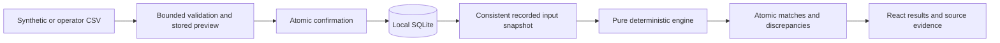

# Current Architecture

This document describes the implemented import, three-source reconciliation, and dashboard behavior. The approved full design is in devpost/spec.md; later slices are not treated as existing functionality here.

## Record Flow

The browser uploads raw CSV or Excel bytes with a source type and safe display filename. The API enforces byte limits while streaming. Bounded readers handle common CSV encodings/separators and actual XLSX/XLS workbooks; a mapping layer recognizes common headings, retains original cells, and records locale interpretation, defaults, corrections, and exclusions. Genuine reference, currency, status, date, and amount problems require attention. Previewing writes an ImportBatch, not financial records. Confirmation inserts every selected validated row and its audit event in one transaction.

The workspace row has separate input and write revisions. Import confirmation advances the input revision. Mutations acquire the workspace write lock with a database-neutral update, so capture cannot mix a partially confirmed batch into a snapshot. SQLAlchemy's SQLite connection factory enables foreign keys and explicit transactions. Its SQLite details remain outside the financial engine.

Snapshot capture copies confirmed orders, payments, and settlements, their row provenance and original values, the input revision, currency precision, explicit fee configuration, and rule version into canonical JSON. A SHA-256 hash identifies that exact snapshot. The engine reads this copy without clock, database, network, or LLM access. Successful persistence writes matches, active allocation keys, discrepancies, summary, completion status, and an audit event together. A failed computation or persistence transaction leaves a failed run without partial accepted output.

ReconciliationMatch stores the explanation and source identities. MatchAllocation has a unique run/relationship-type/record-key constraint. Keys include the logical provider transaction identity so two source rows cannot represent independent allocations of the same transaction. Discrepancies retain rule evidence and candidates; suggested relationships do not become automatic matches.

## Code Boundaries

- backend/app/core: environment configuration, exact monetary parsing, UTC handling, and safe application errors.
- backend/app/db: shared connection and session factories.
- backend/app/models/entities.py: portable ORM schema and application-level history guards.
- backend/alembic: explicit schema migrations that do not import mutable model metadata to create tables.
- backend/app/services/imports: CSV parsing, immutable previews, confirmation, and provenance.
- backend/app/services/reconciliation/engine.py: pure three-source rules and summary calculation.
- backend/app/services/reconciliation/service.py: consistent capture and atomic result persistence.
- backend/app/api: local HTTP endpoints, pagination, search, evidence assembly, and money-safe serialization.
- frontend/src/lib: typed HTTP client and BigInt monetary formatting.
- frontend/src/features: implemented Dashboard, Imports, and Reconciliation screens.
- frontend/src/components: shared controls and source evidence dialog.

The schema also contains investigation and review entities for the remaining approved slices. Human review actions, reports, and AI endpoints are not implemented at this milestone.

## Local Security Boundary

Services bind to loopback by default, with explicit browser origins and trusted host names. Upload filenames never select a filesystem path. SQLAlchemy parameterizes database operations. User-facing errors omit stack traces and provider payloads. Personal context, environment secrets, local databases, and generated test output stay out of Git.

Imported rows and snapshots have no edit/delete API. Audit events have no mutation route, and ORM guards reject ordinary object updates or deletes. Direct database administrators can still modify local files; no cryptographic immutability is claimed.

Public service authentication and PostgreSQL behavior remain unverified and outside this local slice. Review and AI safeguards in the approved specification will receive their own implementation and tests before being reported as working features.
