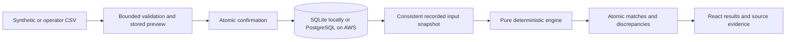

# Current Architecture

## Public Demonstration Boundary

The landing page and /demo routes are public. Demo requests use /api/demo, a separate FastAPI instance and a separate synthetic database. The dispatcher and authorization dependency reject writes; AWS also grants the runtime user SELECT-only access to demo tables. Operator routes retain JWT authorization and use their original database. Independent frontend query caches prevent operator data appearing in demo views. Public visitors can inspect a saved, actual AI hypothesis but cannot submit provider requests. Seed imports, reconciliation, and the example note use the same application services as normal operations.

The site's custom sign-in form sends credentials directly to Cognito through InitiateAuth over HTTPS. Additional verification uses the retained code/PKCE provider flow. The browser retains only a short-lived access token for its tab. No password, refresh token, or API key is persisted in the frontend.

This document describes implemented local and AWS import, reconciliation, dashboard, review, reporting, and optional AI behavior. The approved design and subsequent hosting request are recorded in devpost/spec.md.

## Record Flow

The browser uploads raw CSV or Excel bytes with a source type and safe display filename. The API enforces byte limits while streaming. Bounded readers handle common CSV encodings/separators and actual XLSX/XLS workbooks; a mapping layer recognizes common headings, retains original cells, and records locale interpretation, defaults, corrections, and exclusions. Genuine reference, currency, status, date, and amount problems require attention. Previewing writes an ImportBatch, not financial records. Confirmation inserts every selected validated row and its audit event in one transaction.

The workspace row has separate input and write revisions. Import confirmation advances the input revision. Mutations acquire the workspace write lock with a database-neutral update, so capture cannot mix a partially confirmed batch into a snapshot. SQLAlchemy's SQLite connection factory enables foreign keys and explicit transactions. Its SQLite details remain outside the financial engine.

Snapshot capture copies confirmed orders, payments, and settlements, their row provenance and original values, the input revision, currency precision, explicit fee configuration, and rule version into canonical JSON. A SHA-256 hash identifies that exact snapshot. The engine reads this copy without clock, database, network, or LLM access. Successful persistence writes matches, active allocation keys, discrepancies, summary, completion status, and an audit event together. A failed computation or persistence transaction leaves a failed run without partial accepted output.

ReconciliationMatch stores the explanation and source identities. MatchAllocation has a unique run/relationship-type/record-key constraint. Keys include the logical provider transaction identity so two source rows cannot represent independent allocations of the same transaction. Discrepancies retain rule evidence and candidates; suggested relationships do not become automatic matches.

## Code Boundaries

- backend/app/core: environment configuration, exact monetary parsing, UTC handling, and safe application errors.
- backend/app/db: shared connection and session factories.
- backend/app/models/entities.py: portable ORM schema and application-level history guards.
- backend/alembic: explicit schema migrations that do not import mutable model metadata to create tables.
- backend/app/services/imports: CSV parsing, immutable previews, confirmation, and provenance.
- backend/app/services/reconciliation/engine.py: pure three-source rules and summary calculation.
- backend/app/services/reconciliation/service.py: consistent capture and atomic result persistence.
- backend/app/api: local HTTP endpoints, pagination, search, evidence assembly, and money-safe serialization.
- frontend/src/lib: typed HTTP client and BigInt monetary formatting.
- frontend/src/features: implemented Dashboard, Imports, Reconciliation, Investigations, and Reports screens.
- frontend/src/components: shared controls and source evidence dialog.

The review service validates state transitions, optimistic case versions, snapshot candidate membership, currency and amount equality, eligibility, and allocation uniqueness. Notes, decisions, version increments, and audit events commit together. Manual reversal releases allocation rows but retains the relationship and its history. Current summaries use active relationships and unresolved case state; original automatic summaries remain unchanged. Reports export both bases with exact currency values and neutralize formula-like CSV cells. The optional AI service captures bounded case evidence, requests a structured explanation from an operator-configured provider, validates supporting IDs, and rechecks case version before saving it. A stale or unsupported response is not persisted. No AI route calls the match or case-disposition actions.

## Local Security Boundary

Services bind to loopback by default, with explicit browser origins and trusted host names. Upload filenames never select a filesystem path. SQLAlchemy parameterizes database operations. User-facing errors omit stack traces and provider payloads. Personal context, environment secrets, local databases, and generated test output stay out of Git.

Imported rows and snapshots have no edit/delete API. Audit events have no mutation route, and ORM guards reject ordinary object updates or deletes. Direct database administrators can still modify local files; no cryptographic immutability is claimed.

The AWS demonstration uses CloudFront/private S3, Cognito password sign-in with code/PKCE verification fallback, a Gateway JWT authorizer for operator routes, and Lambda with private encrypted PostgreSQL. The runtime and maintenance functions share the same application modules. Secrets stay in Secrets Manager; native Windows builds package Linux wheels and the RDS public CA bundle. The private maintenance function applies migrations and verifies a separate synthetic database. Actual hosted browser journeys and OpenAI investigations passed; unauthenticated operator requests and altered-signature requests were rejected. See [hosting verification](production-readiness.md) for the exact evidence and operational limits.

AI input includes explicit currency precision and exact decimal/display amounts from the shared integer formatter. An initial local live amount-unit error prompted that correction; corrected local and hosted responses were inspected. Neither the limited synthetic checks nor structured validation establishes general model accuracy. Hypotheses still require human review.
